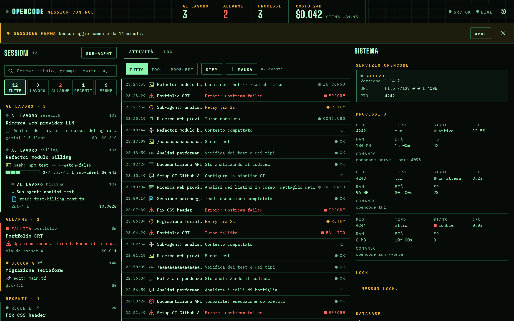
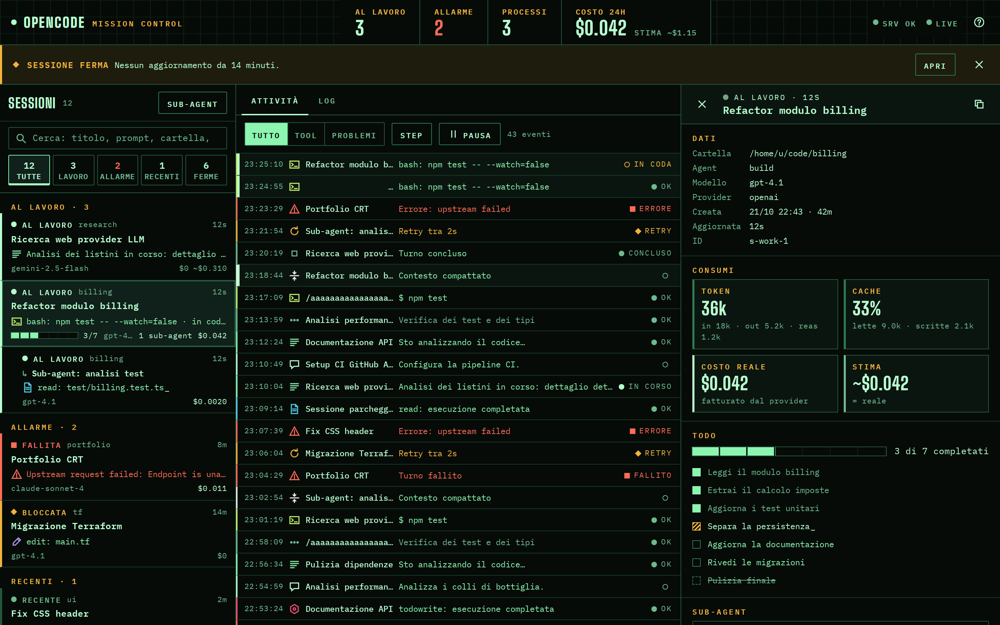
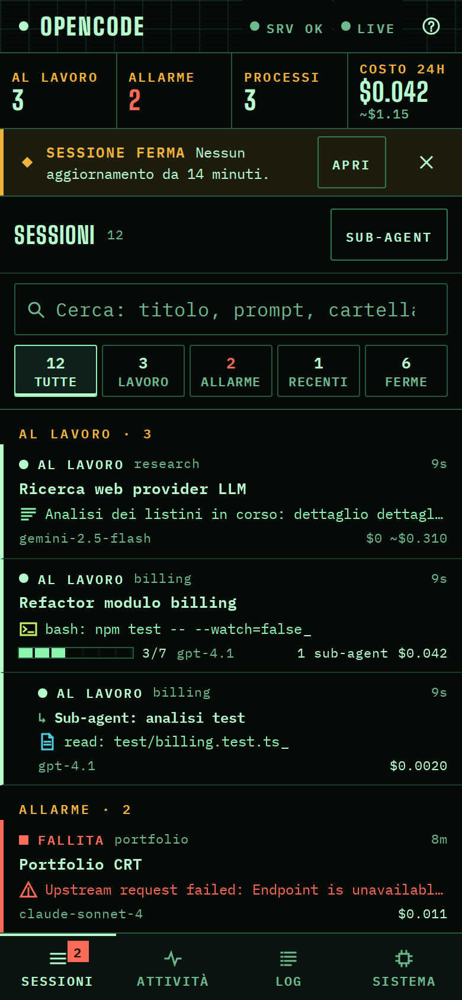

<div align="center">

# opencode mission control

**A real-time local dashboard for [opencode](https://opencode.ai) v2 sessions.**
See which agents are working, which tool is running right now, what failed and what it cost.

[](LICENSE)
[](https://nodejs.org)
[](package.json)
[](https://opencode.ai)



[Features](#features) · [Quick start](#quick-start) · [How it works](#how-it-works) · [API](#api) · [Shortcuts](#keyboard-shortcuts) · [Development](#development)

</div>

## Why

When you delegate coding work to opencode (from a terminal, from scripts or from another agent), sessions run in the background service and you lose sight of them. This dashboard reads the local opencode database and shows every session live: the command being executed, the file being edited, the provider that is retrying, the todo list advancing. It runs on your machine, needs no account and has zero npm dependencies.

## Features

- **Live tool stream.** Tool calls appear as `running` the moment they start and flip to `ok` or `error` when they finish, updated in place.
- **Session status at a glance.** Working, recent, idle, failed, stuck, suspended and provider retry, each with a lamp shape and a text label (never colour alone).
- **Session detail.** Full transcript with prompts, reasoning, text, tool input and output, step tokens, todos, sub-agent sessions, real and estimated cost.
- **Cost tracking.** Billed cost from the provider plus an estimate for free models, priced on their paid twin from the opencode model catalog.
- **System panel.** opencode service status, `opencode` processes (zombies included), lock files and a raw log view.
- **Stall alerts.** Detects runs that never created a session, sessions silent for too long and orphaned locks. Also exposed as an SSE endpoint you can watch from scripts.
- **Keyboard first, mobile ready.** Shortcuts for everything, a bottom navigation on phones, WCAG 2.2 AA contrast, reduced-motion support.

<table>
<tr>
<td width="68%"></td>
<td width="32%"></td>
</tr>
</table>

## Quick start

Requirements: Node.js 22.5 or newer (it uses the built-in `node:sqlite`) and opencode v2 on the same machine.

```bash
git clone https://github.com/gerardocipriano/opencode-dashboard.git
cd opencode-dashboard
./start.sh
```

Open <http://localhost:3456>. There is nothing to install.

### Run it as a user service (Linux)

```ini
# ~/.config/systemd/user/opencode-dashboard.service
[Unit]
Description=opencode dashboard on :3456

[Service]
WorkingDirectory=%h/opencode-dashboard
Environment=NODE_NO_WARNINGS=1
ExecStart=/usr/bin/env node server.js
Restart=on-failure

[Install]
WantedBy=default.target
```

```bash
systemctl --user daemon-reload
systemctl --user enable --now opencode-dashboard.service
```

### Configuration

| Variable | Default | Purpose |
|---|---|---|
| `PORT` | `3456` | HTTP port |
| `PUBLIC_DIR` | `./public` | Directory with the front-end files |
| `OC_STALL_SECS` | `180` | Seconds of silence before a running session raises a stall alert |
| `OC_BIRTH_SECS` | `150` | Seconds an `opencode run` process may live without creating a session |

## How it works

opencode v2 stores sessions in `~/.local/share/opencode/opencode.db`. Each session lives in `session_v2`, and each message in `session_message` as a typed row (`user`, `assistant`, `idle`, `synthetic`, `compaction`). Assistant rows are rewritten in place while the model streams, so the server polls rows by `time_updated` once per second, diffs their content per client and pushes only what changed over Server-Sent Events. The browser upserts every item by id, which is how a single tool call moves from `pending` to `running` to `completed` without duplicates.

The front-end is plain HTML, CSS and an ES module. It never uses `innerHTML`: every row comes from a `<template>` and is patched by id, so a refresh never recreates the list or closes a panel you opened.

```
opencode service ──writes──▶ opencode.db (SQLite, WAL)
                                  │ read-only polling, 1 s
                                  ▼
                            server.js ──SSE──▶ browser (public/)
```

Sessions created by opencode v1 are still readable: the detail view falls back to the legacy `message` and `part` tables.

## API

| Endpoint | Type | Description |
|---|---|---|
| `/api/stream` | SSE | `overview` snapshots and live `part` items (upsert by `id`) |
| `/api/overview` | JSON | Latest 50 sessions with status, last activity, todos and costs |
| `/api/session?id=` | JSON | Full session detail and transcript |
| `/api/activity?since=` | JSON | Activity items updated after a timestamp (last 6 h) |
| `/api/alerts` | SSE | `alert` events for stalls and stuck locks; `?once=1` returns JSON |
| `/api/processes` | JSON | Running `opencode` processes |
| `/api/service` | JSON | opencode background service status |
| `/api/locks` | JSON | Lock files and their heartbeat |
| `/api/log-stream` | SSE | Tail of the opencode server log |
| `/api/health` | JSON | Server and database health |

Watch for stalls from a shell:

```bash
curl -sN http://localhost:3456/api/alerts | grep --line-buffered '^data:'
```

## Keyboard shortcuts

| Key | Action |
|---|---|
| `/` | Search sessions |
| `j` `k` | Move through the session list |
| `.` `,` | Open next or previous session |
| `1` `2` `3` | Activity, Log, System |
| `a` | Show only sessions that need attention |
| `p` | Pause the activity feed |
| `g` | Jump to the newest activity |
| `Esc` | Close the detail or clear the search |
| `?` | Show all shortcuts |

## Development

Append `?mock=1` to the URL to run the UI on deterministic fake data, without opencode. `?mock=1&still=1` starts with the live tick paused. In mock mode `window.__ocmock` lets you emit parts, drop the connection, change a session status or send a burst of events, which is what the acceptance tests use.

Project layout:

```
server.js          HTTP server, SQLite reader, SSE streams, alerts
public/index.html  markup and <template> elements
public/styles.css  design tokens and components
public/app.js      state, SSE client, rendering
```

The visual direction, phosphor green on near black with an amber accent, uses Big Shoulders Display and IBM Plex Mono from Google Fonts.

## Limitations

- Read-only: the dashboard never writes to the opencode database and cannot start or stop sessions.
- Linux first. Process details (state, memory, age, open files) come from `/proc`, so on macOS the process panel shows only PID, CPU and command.
- The log view is global, because opencode v2 log lines rarely carry a session id.

## License

[MIT](LICENSE)
