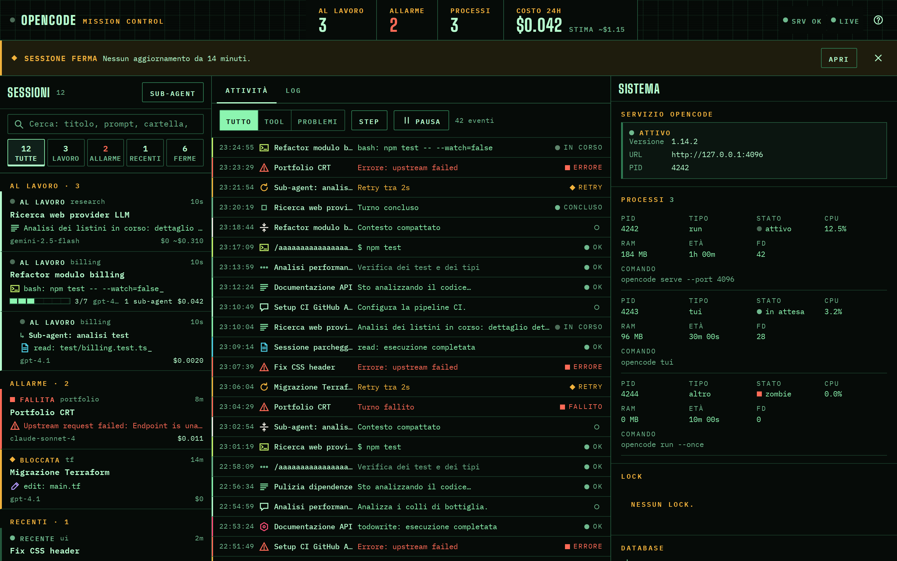
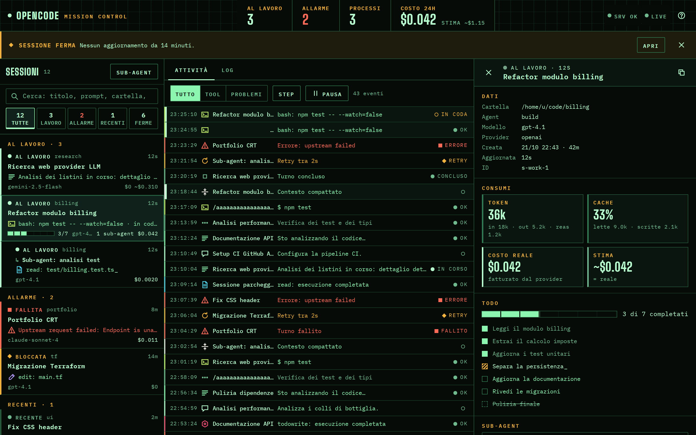
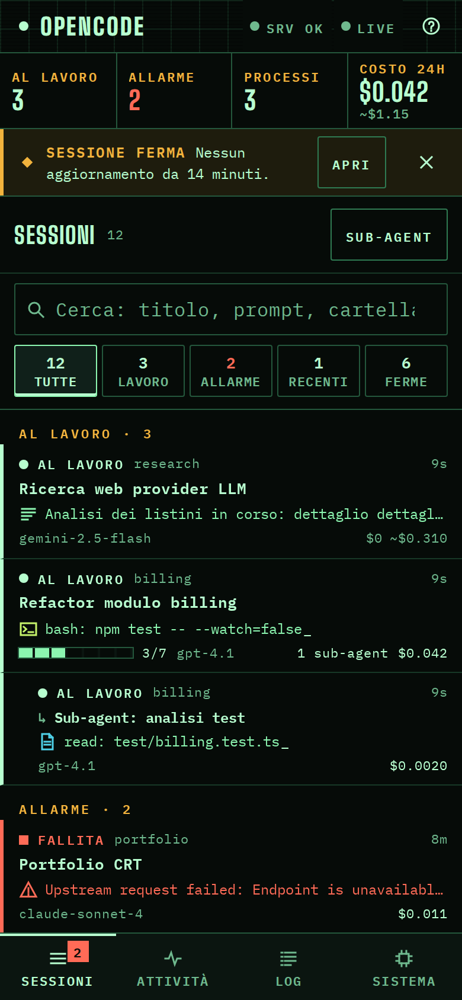

<div align="center">

# opencode mission control

**A real-time local dashboard for [opencode](https://opencode.ai) v2 sessions.**
See which agents are working, which tool is running right now, what failed and what it cost.

[](LICENSE)
[](https://nodejs.org)
[](package.json)
[](https://opencode.ai)



[Features](#features) · [Quick start](#quick-start) · [How it works](#how-it-works) · [API](#api) · [Shortcuts](#keyboard-shortcuts) · [Development](#development)

</div>

## Why

When you delegate coding work to opencode (from a terminal, from scripts or from another agent), sessions run in the background service and you lose sight of them. This dashboard reads the local opencode database and shows every session live: the command being executed, the file being edited, the provider that is retrying, the todo list advancing. It runs on your machine, needs no account and has zero npm dependencies.

## Features

- **Live tool stream.** Tool calls appear as `running` the moment they start and flip to `ok` or `error` when they finish, updated in place.
- **Session status at a glance.** Working, recent, idle, failed, stuck, suspended and provider retry, each with a lamp shape and a text label (never colour alone).
- **Session ordering.** Grouped by status by default; the *Stato/Tempo* toggle re-sorts every session in a single chronological list, newest activity first.
- **Session detail.** Full transcript with prompts, reasoning, text, tool input and output, step tokens, todos, sub-agent sessions, real and estimated cost.
- **Cost tracking.** Billed cost from the provider plus an estimate for free models, priced on their paid twin from the opencode model catalog.
- **System panel.** opencode service status, `opencode` processes (zombies included), lock files and a raw log view.
- **Stall alerts.** Detects runs that never created a session, sessions silent for too long and orphaned locks. Also exposed as an SSE endpoint you can watch from scripts.
- **Claude Code sessions.** Live Claude Code sessions appear next to opencode's, with model, coarse status, current tool name and sub-agents, and each one is linked to the opencode sessions it delegated to.
- **Keyboard first, mobile ready.** Shortcuts for everything, a bottom navigation on phones, WCAG 2.2 AA contrast, reduced-motion support.

<table>
<tr>
<td width="68%"></td>
<td width="32%"></td>
</tr>
</table>

## 2D view

`/2d.html` is an alternative, animated view of the same data: every session is a character on a map. Claude Code sessions appear as characters with their sub-agents, linked to the opencode sessions they delegated to. Append `?mock=1` for a demo mode on fake data, with no opencode or Claude Code needed.

### Adding characters and backdrops

Characters and backdrops are data. No engine change is needed.

1. Add the frames to `public/2d/sprites.png`. Crop each frame tight to the figure and keep it within 64x64 px. The bottom edge of a frame is the feet baseline and its horizontal centre is the character's position, so keep the feet on the bottom row of every frame.
2. Describe the frames in `public/2d/atlas.json`. A frame is `frames["<name>:<n>"] = [x, y, width, height]` in sheet pixels. An animation is `chars.<name>.<anim> = { "face": "F", "frames": ["<name>:0", "<name>:1"] }`. `face` is the direction the frames look: `F` front, `L` or `R` side (mirrored to match the walking direction), `B` back.
3. Add the name to a role pool in the `CAST` table at the top of the casting section in `public/2d.js`. A pool with several names picks one per session by hash of its id. Optionally add a display name to `CHAR_LABEL`.
4. Open `/2d.html?mock=1` and check every state.

Animation names. Required: `stand` (also the portrait and the click target). Optional: `walk`, `walkSide`, `back`, `sit`, `charge`, `blast`, `melee`, `hurt`, `ko`, `koFlash`, `kameCharge`, `kameFire`, `power`, `portrait`. A missing animation falls back to a close one and finally to `stand`, so a character with only `stand` and `walk` works in every state. A name in `CAST` that is missing from the atlas is skipped with a console warning.

Backdrops work the same way: add the PNG under `public/2d/bg/`, register it as `bg.<key> = { "src": "bg/<file>.png", "w": 239, "h": 160 }` in `atlas.json`, and list the key in the `bgs` of a zone in the `ZONES` table.

## Quick start

Requirements: Node.js 22.5 or newer (it uses the built-in `node:sqlite`) and opencode v2 on the same machine.

```bash
git clone https://github.com/gerardocipriano/opencode-dashboard.git
cd opencode-dashboard
./start.sh
```

Open <http://localhost:3456>. There is nothing to install.

### Run it as a user service (Linux)

```ini
# ~/.config/systemd/user/opencode-dashboard.service
[Unit]
Description=opencode dashboard on :3456

[Service]
WorkingDirectory=%h/opencode-dashboard
Environment=NODE_NO_WARNINGS=1
ExecStart=/usr/bin/env node server.js
Restart=on-failure

[Install]
WantedBy=default.target
```

```bash
systemctl --user daemon-reload
systemctl --user enable --now opencode-dashboard.service
```

### Configuration

| Variable | Default | Purpose |
|---|---|---|
| `PORT` | `3456` | HTTP port |
| `PUBLIC_DIR` | `./public` | Directory with the front-end files |
| `OC_STALL_SECS` | `180` | Seconds of silence before a running session raises a stall alert |
| `OC_BIRTH_SECS` | `150` | Seconds an `opencode run` process may live without creating a session |
| `OC_CLAUDE` | `1` | Set to `0` to turn off everything about Claude Code sessions |
| `CLAUDE_DIR` | `~/.claude` | Claude Code data directory |

## How it works

opencode v2 stores sessions in `~/.local/share/opencode/opencode.db`. Each session lives in `session_v2`, and each message in `session_message` as a typed row (`user`, `assistant`, `idle`, `synthetic`, `compaction`). Assistant rows are rewritten in place while the model streams, so the server polls rows by `time_updated` once per second, diffs their content per client and pushes only what changed over Server-Sent Events. The browser upserts every item by id, which is how a single tool call moves from `pending` to `running` to `completed` without duplicates.

The front-end is plain HTML, CSS and an ES module. It never uses `innerHTML`: every row comes from a `<template>` and is patched by id, so a refresh never recreates the list or closes a panel you opened.

```
opencode service ──writes──▶ opencode.db (SQLite, WAL)
                                  │ read-only polling, 1 s
                                  ▼
                            server.js ──SSE──▶ browser (public/)
```

Sessions created by opencode v1 are still readable: the detail view falls back to the legacy `message` and `part` tables.

### Claude Code sessions

Claude Code launches opencode through its Bash tool, and opencode records nothing that points back, so the link is rebuilt from Claude's side. The collector (`lib/claude.js`) reads, read-only:

- `~/.claude/sessions/<pid>.json` for the live sessions (a file counts only if the pid exists and its start time matches; stale files are ignored). The `*.key` files next to them are never opened.
- `~/.claude/projects/<project>/<session>.jsonl`, the transcript, incrementally from the last byte offset (the last 2 MB on first sight), for the model, the pending tool call and the `opencode run` launches.
- `.../<session>/subagents/agent-*.meta.json` for sub-agent type and state. Launches made by sub-agents count for the parent session.

A launch is a Bash call containing `opencode run`, with its `--title`, its `cd <dir> &&` prefix or `--dir`, and whether it resumes a session. It is joined to an opencode session in this order, each opencode session used once:

1. `--session <id>` names the session outright.
2. A title ending in `-<first 8 characters of the Claude session id>` links directly, whenever it ran. To opt in, launch with `--title "oc-<task>-${CLAUDE_CODE_SESSION_ID:0:8}"`.
3. Same title, and the opencode session created from 5 s before to 120 s after the launch. With several candidates the one in the launch directory wins, then the nearest in time; a live `opencode run` process that carries the same `CLAUDE_CODE_SESSION_ID` and title serves as the time reference.

Each opencode session in the API gets `claude: {id, short}` when a link exists, otherwise `null`. A delegation that cannot be matched is still listed, with `sessionId: null`.

Deliberately not exposed: prompts, message text, tool inputs and outputs (including file paths), the session name and sub-agent descriptions. What leaves the server is ids, pid, kind, directory, project name, model, a coarse status (`working`, `waiting`, `idle`), tool names, sub-agent type and state, timestamps and delegation titles.

## API

| Endpoint | Type | Description |
|---|---|---|
| `/api/stream` | SSE | `overview` snapshots (sessions, `claude`, processes, service, cost) and live `part` items (upsert by `id`) |
| `/api/overview` | JSON | Latest 50 sessions with status, last activity, todos, costs and the `claude` link |
| `/api/session?id=` | JSON | Full session detail and transcript |
| `/api/activity?since=` | JSON | Activity items updated after a timestamp (last 6 h) |
| `/api/alerts` | SSE | `alert` events for stalls and stuck locks; `?once=1` returns JSON |
| `/api/claude` | JSON | Live Claude Code sessions with sub-agents and linked delegations (`[]` when `OC_CLAUDE=0`) |
| `/api/processes` | JSON | Running `opencode` processes |
| `/api/service` | JSON | opencode background service status |
| `/api/locks` | JSON | Lock files and their heartbeat |
| `/api/log-stream` | SSE | Tail of the opencode server log |
| `/api/health` | JSON | Server and database health |

Watch for stalls from a shell:

```bash
curl -sN http://localhost:3456/api/alerts | grep --line-buffered '^data:'
```

## Keyboard shortcuts

| Key | Action |
|---|---|
| `/` | Search sessions |
| `j` `k` | Move through the session list |
| `.` `,` | Open next or previous session |
| `1` `2` `3` | Activity, Log, System |
| `a` | Show only sessions that need attention |
| `p` | Pause the activity feed |
| `g` | Jump to the newest activity |
| `Esc` | Close the detail or clear the search |
| `?` | Show all shortcuts |

## Development

Append `?mock=1` to the URL to run the UI on deterministic fake data, without opencode. `?mock=1&still=1` starts with the live tick paused. In mock mode `window.__ocmock` lets you emit parts, drop the connection, change a session status or send a burst of events, which is what the acceptance tests use.

Run the tests with `npm test` (`node:test`, no dependencies). They build fake Claude and opencode data in a temp directory, so they never touch your real sessions.

Project layout:

```
server.js            HTTP server, SQLite reader, SSE streams, alerts
lib/claude.js        Claude Code session collector, status and delegation join
test/                unit and integration tests
public/index.html    markup and <template> elements
public/styles.css    design tokens and components
public/app.js        state, SSE client, rendering
public/2d.html       2D view: markup
public/2d.css        2D view: styles
public/2d.js         2D view: scenes and rendering
public/2d-data.js    2D view: data adapter and mock data
public/2d/           2D view: image assets
```

The visual direction, phosphor green on near black with an amber accent, uses Big Shoulders Display and IBM Plex Mono from Google Fonts.

## Limitations

- Read-only: the dashboard never writes to the opencode database and cannot start or stop sessions.
- Linux first. Process details (state, memory, age, open files) come from `/proc`, so on macOS the process panel shows only PID, CPU and command.
- Linking Claude Code sessions to opencode sessions is a heuristic. Two identical titles launched within seconds in the same directory can be swapped, and a launch that never created a session can claim a neighbour's. Use the `-<session id prefix>` title suffix for exact links.
- The server has no authentication and listens on all interfaces. Claude data is limited to the fields listed above, but run it only on a trusted network.
- The log view is global, because opencode v2 log lines rarely carry a session id.

## License

[MIT](LICENSE)
